# CI Triage Agent: design

Classifies one failing test as **product bug**, **flaky test**, **environment issue** or **test gap**, with a confidence level, the evidence behind it, and a proposed next action. It runs in **shadow mode**: it reports, it never files a ticket, quarantines a test or reruns a job.

It exists to cut *mean time to triage* (target under 4 working hours, `test-strategy.md` §6) and to stop two costly mistakes: calling a real bug "flaky", and treating a wall of 504s as many product bugs.

## Workflow

```mermaid
flowchart LR
  A[CI failure<br/>test name, log, git diff] --> B[Evidence collector<br/>results.json, sibling failures,<br/>docker health, TC id]
  B --> C[Signal rules<br/>cheap hints, never verdicts]
  C --> D[Prompt builder<br/>defects from bugs/README.md]
  D --> E[claude -p<br/>no tools, JSON schema]
  E --> F[Schema check<br/>retry once]
  F --> G[Guardrails<br/>only ever more cautious]
  G --> H[Report<br/>markdown or JSON]
  H --> I{Human}
  I -->|confirms or corrects| J[Eval history]
```



One structured model call, not a free-roaming agent. Everything that needs no judgement (parsing the Playwright report, spotting unhealthy containers, matching known defect signatures, and classifying a wall of 504s) is plain code. The model only weighs the evidence. That keeps it cheap (about 8 seconds and a fraction of a cent per failure), testable, and impossible for it to run a destructive command, because it has no tools.

## What the agent decides, and what stays with a human

| Agent decides | Human decides |
|---|---|
| Which of the four classes fits best, and the runner-up | Whether to accept it. In shadow mode every result is confirmed |
| Confidence, and which evidence supports it | Filing the bug, setting severity, assigning the fix |
| Whether the failure matches a known defect (`DEF-xx`) | Quarantining or deleting a test (5 working day rule) |
| A proposed next action and owning pod | Restarting or changing the environment |
| Whether it needs a person (`needs_human`) | **Anything touching money**: currency, payment, checkout, pricing |

Escalation to a human is forced, in code, when confidence is low, when evidence cannot be verified, or when a money-area failure is called flaky.

## Rules-only baseline (`src/baseline.ts`)

One failure type is decided by a rule, with no model call: **a wall of 504s**. It fires only when all of these hold:

1. The test failed on **every attempt** and Playwright marked it `unexpected` (a retry-pass is `flaky` and goes to the model).
2. **Every attempt's own error is a 504** (`Received: 504` or `504 Gateway Timeout`). `Expected: 504` and a 504 on one attempt followed by a 500 do not count.
3. **At least 3 other failed tests in the same run also ended in a 504.** One or two could be a product timeout.
4. The diff touches **no service on the request path** (`src/checkout`, `cart`, `payment`, `currency`, `product-catalog`, `quote`, `shipping`, `frontend`, `frontend-proxy`). A change to `src/ad` does not block it.

The verdict is `environment_issue`, `restart_env`, Quality Platform, high confidence, with the real 504 line and the sibling count as evidence, then the normal guardrails. It is marked `decidedBy: rule`, costs 0 s and no model call, and does not use up the `--max 6` cap, so every failure in a wall gets a verdict. `--no-rules` forces everything to the model.

**Why only 504.** I counted the status codes in the two real outages I captured. Pausing `product-catalog` gave 504 on 16 of 19 tests. Stopping `currency` gave almost no 504s: 10 tests failed 500 twice, 4 failed 500 once and 2 failed 504 then 500. So a 504 rule covers one kind of outage and not the other. It does not extend to 500, because the product's own bugs also return 500. Timeouts, locator failures, a `TypeError` in test code (the `currency` outage produced one at `checkout.spec.ts:53`) and wrong values stay with the model.

**Not covered, on purpose.** The `docker stop currency` outage still costs model calls. Catching it by rule needs `docker ps -a` and a check for exited, paused or restarting containers, which the current CI step does not collect and the current detector (`unhealthy` only) misses.

**Measured so far.** On the real `docker pause` run, 11 of the 14 failures are decided by rule and 3 go to the model. In the eval, 2 of 30 cases take the rule (`env-01`, `env-04`), both correct. `pb-13` is a hard negative: a 504 wall caused by a `time.Sleep` added to `src/checkout`; the rule steps aside and the model gets it right. That is a small precision check, not a precision estimate. Unit tests cover the cases that must not fire.

**Risk.** A real regression that makes many tests time out would be called an environment issue if the diff does not touch a request-path service (for example a change to a shared library or the Compose file). The verdict says "do not file a bug from this run", so a human still sees it, but it is the failure mode to watch.

## Output contract

Enforced by `--json-schema` and again by zod (`src/types.ts`): `classification`, `confidence`, `summary`, `evidence[] {source, quote, why}`, `alternative {classification, why_not}`, `known_defect`, `next_action {type, detail, owner_pod}`, `needs_human`. The mandatory runner-up pushes the model to commit to why it rejected the alternative.

## Guardrails (`src/guardrails.ts`)

They only make a result more cautious; they never change the class.

1. Every evidence quote must appear in what the model was given. Invented quotes are removed (this fired in the v1 run).
2. `high` confidence needs two evidence items from different sources, otherwise it is downgraded to `medium`.
3. Low confidence, or no verifiable evidence left, forces `needs_human`.
4. A money-area failure classified as flaky forces `needs_human`.

## Rules the prompt carries

All of these come from this repo's own history, not generic advice:

- A wall of 502/503/504 or timeouts, or an unhealthy container, is environment (`automation-strategy.md` §4).
- **An intermittent failure is not automatically flaky.** If the server is right and the UI is wrong, it is a product bug (DEF-10).
- A `knownDefect('DEF-xx')` test fails by design while the bug exists, so the agent does not re-triage it (the CI gate accepts it). One that now passes means the defect was probably fixed: test gap, remove the marker.
- Locator failure plus a diff to page objects or `data-cy` hooks: test gap.
- Cross-test interference through shared stack state (flags) is a test-isolation flaw, so flaky, not environment.

## Running it

```bash
cd agentic && npm ci
npm run check                       # typecheck + 12 unit tests, no model, no stack
npm run triage -- --test "<name>" --log fail.log --diff change.patch \
    [--results ../automation/test-results/results.json] [--docker-ps ps.txt] [--model sonnet] [--json]
npm run eval                        # 29 cases, about 5 minutes (cached cases are free)
```

`--docker-ps` takes the output of `docker ps --format '{{.Names}} {{.Status}}'`.

## How the model is reached (no API key)

`src/llm/ClaudeCodeCli.ts` runs `claude -p` with `--tools ""`, `--json-schema`, `--no-session-persistence` and `--setting-sources ""`, so it uses your logged-in Claude Code session, has no tools, and ignores your hooks, memory and CLAUDE.md. `ANTHROPIC_API_KEY` is deleted from the child's environment so it cannot silently fall back to a key. `--bare` is deliberately not used: it only accepts an API key.

## In CI

The `agent` job in [`.github/workflows/e2e.yml`](../.github/workflows/e2e.yml) runs after the Playwright job, on every trigger, and **never fails the build** (shadow mode):

| Step | When | What it does |
|---|---|---|
| `npm run check` | Always | Typecheck and 12 unit tests. No model, no secret |
| Eval (29 cases) | Push to `main`, nightly, manual, **and only if the secret exists** | Re-runs the eval through Claude Code. Not on PRs: it is 29 model calls |
| Triage this run's failures | Always (model only if the secret exists; the 504 rule needs no secret) | Reads `results.json`, triages up to 6 failed or flaky tests with the last commit's diff and container health. Without the secret it reports the rule-based signals only and says so |
| Report | Always | Builds the page and appends a summary to the job's `GITHUB_STEP_SUMMARY` |

The `dashboard` job then publishes the report **inside the existing GitHub Pages site** at `/agent/` (a repository can only deploy one Pages site), linked from the QA metrics dashboard. The page says plainly when the eval was *not* re-run and it is showing the last committed result.

**Setup, once:** run `claude setup-token` on your machine and save the result as the repository secret `CLAUDE_CODE_OAUTH_TOKEN`. That is a subscription token for Claude Code, not an API key, so the no-API-key rule still holds. The workflow installs the CLI at the version the flags were verified on (`@anthropic-ai/claude-code@2.1.302`).

**Not yet verified:** the model steps have only been run locally, on a login session. The first CI run with the secret is the real test of the token path. If it fails, the report falls back to the committed eval and the signals-only triage, and the job stays green.

**Costs:** each main/nightly/manual run spends about 29 calls (about 5 minutes) on the eval, plus one call per triaged failure, against your subscription's limits. If that is too much, drop the eval step to nightly only by changing its `if`.

Failures are triaged from the **last commit's diff**. On a squash or a multi-commit push that is a partial picture; the agent sees it as "the diff", so treat its diff-based reasoning with that in mind.

To run unattended on an API key instead, add an API-key implementation of `LlmClient` (`src/llm/LlmClient.ts`) and pass it to `triage()`. Nothing else changes.

## Evaluation

29 cases in `evals/cases/`: the original 14 (3 each for product bug, environment, flaky, test gap, plus 2 traps) and 15 added after the v2 prompt was frozen. Latest: [`evals/results/latest.md`](evals/results/latest.md). First run: [`evals/results/v1.md`](evals/results/v1.md).

| Prompt | Accuracy | Notes |
|---|---|---|
| v1 | 12/14 | Misses: `fl-02` and `fl-03` (both expected flaky) |
| v2 | 14/14 on the original 14 | Added the shared-state rule; fixed a flaw in case `fl-02` |
| v2, unchanged, on the 15 added cases | **12/15** | The held-out number. Misses: `mx-01`, `mx-02`, `pb-09`. Full run: [`evals/results/v2-29.md`](evals/results/v2-29.md) |
| v2.1, all 29 | 28/29 (held-out part 14/15) | **No new rules.** Only the wording changed, because the tests now use `knownDefect()` instead of `test.fail()` (see below). The 12/15 to 14/15 move is run-to-run noise, not improvement: `mx-02` and `pb-09` flip between runs with the same prompt |

**The 15 added cases** (`cohort: added-after-v2` in `case.json`, run with the prompt untouched):

- **7 real product bugs never seen before** (DEF-02, 03, 04, 06, 08, 09, 11), using error text from a live run.
- **3 real environment failures captured by breaking the stack on purpose:** `docker pause product-catalog` (504 wall, docker ps says "Paused", not "unhealthy") and `docker stop currency` (500s on every checkout; the stopped container is absent from docker ps). One of them (`mx-01`) is a `knownDefect('DEF-05')` test that passes only because checkout is down (it asserts the order is refused, and every order is refused). Its marker looks stale, but the cause is the outage.
- **2 defects that are not in the defect log** (`pb-11` total omits shipping, `pb-12` recommendations crash). The right answer is `known_defect: null`, so these test for forced DEF matches.
- **3 mixed-signal cases** (`mx-02` a 504 wall plus a unique price mismatch; `mx-03` flaky retry inside the checkout money flow; `mx-04` an unhealthy container plus a renamed `data-cy`).

How to read that honestly:

- **29 cases is directional, not statistically strong.**
- **The v2 gain on the original 14 is tuned, not held out. The 15 added cases are the held-out check (12/15 on the first run, 14/15 on the second with the same rules).** `fl-03` was fixed by a prompt rule written after seeing it miss. `fl-02` was a mistake in my case: its log said "server state correct", the same diagnostic that marks the DEF-10 trap, so two cases were indistinguishable. I removed that line and recorded the change in the case file. A held-out set is the next thing to build.
- **13 of 29 cases are real** (3 original, 10 added). `tr-02` was real while the tests used `test.fail()`, but a fixed bug now shows up as a quiet pass, so its log is constructed. The real ones use error text, results and `docker ps` from live runs against the pinned demo `ac0443b`. **There is still no real flaky case**: a flake cannot be produced on demand (I tried restarting `cart` mid-run; the suite finished first). The flaky, test-gap and some environment cases are *constructed* in Playwright's real error format, because producing them for real means breaking the stack on purpose. Their logs also contain some diagnostics (such as "flag restored 800ms later") that a real CI log would only have if the test were written to print them. Real nightly failures will be harder.
- **Beyond the class, four more things are scored**, against labels in each `case.json` that I wrote from the pod map and strategy doc (not copied from model output). Where policy allows several answers, the label lists them. (1) `next_action.type`; (2) `owner_pod`; (3) **false defect matches**: a DEF-xx named that is not the case's defect, or named when the case has none; (4) **escalation**: whether `needs_human` matches whether a person should look, split into *missed* (should have escalated, did not: the dangerous one) and *needless* (escalated when not needed: costs reviewer time). They are reported next to the success bar but are not part of it, because the bar was fixed before the first run. Current result: action 13/14, owner 13/14, false defect matches 0, escalation 8/14 with 0 missed and 6 needless. The needless escalations come mostly from the low-confidence and money-area guardrails, which are deliberately cautious. The `tr-01` miss is real: the agent routes a frontend cart bug to Checkout & Payments while the defect log lists the component as `frontend`.
- **Stability is weaker than I first said.** Three runs each of the four delicate original cases showed no change of class. But three runs of four of the added cases (v2.1) showed `pb-09` (product bug at high confidence once, test gap at low confidence twice) and `mx-02` (product bug twice, environment once) changing class, and `mx-01` is a stable miss. Treat any single run on a hard case as roughly a coin flip, and read the 29-case score as 28 plus or minus a couple.

### Known-defect tests (`knownDefect()`)

The automation no longer uses `test.fail()`. A test marked `knownDefect('DEF-xx')` asserts the correct behaviour and really fails while the bug exists (annotation type `defect`); `automation/scripts/gate.mjs` accepts those failures and turns the build red if one starts passing. What changed for the agent:

- `ci-triage.ts` skips a **failing** known-defect test: the bug is documented and the gate already accepts it. Triaging it again would burn model calls and crowd out new failures.
- It does triage a known-defect test that **passes** (Playwright status `expected` with a `defect` annotation): the gate has gone red and the agent says whether the bug looks fixed. Signal `known-defect-now-passing` replaces `stale-expected-failure`.
- Prompt rule 3 and the test-gap definition now say `knownDefect` and "marker" instead of `test.fail` and "annotation" (prompt v2.1).
- Eval cases `tr-02` and `mx-01` were renamed (`tr-02-fixed-known-defect`, `mx-01-fixed-marker-masks-outage`) and now carry a passing result with a `defect` annotation. The older snapshots `v1.*` and `v2-29.*` still use the old ids.
- **Gap this leaves:** the gate accepts a known-defect test failing for *any* reason, so one that fails with a 504 during an outage is hidden from the agent. Only the unmarked tests failing alongside it are triaged. If you want those looked at, ci-triage could also pick known-defect failures whose error is not an assertion mismatch.

Success bar, set before the first run: at least 85% correct, every `high`-confidence answer correct, no S1 product bug labelled flaky. v1 and v2 both met it.

## Known limits

- Logs and diffs are clipped to 6,000 characters each (head and tail kept), so a very long trace loses its middle.
- It sees one failure at a time. Sibling failures only arrive as a list of test names, not their logs.
- The signal rules and defect signatures are hand-written for 11 known defects; a new defect is only recognised by the model reading the defect table.
- Nothing yet records the human's verdict, so the shadow-mode agreement rate cannot be computed. That is the first thing to add before trusting it.
