# CI Triage Agent: design

Classifies one failing test as **product bug**, **flaky test**, **environment issue** or **test gap**, with a confidence level, the evidence behind it, and a proposed next action. It runs in **shadow mode**: it reports, it never files a ticket, quarantines a test or reruns a job.

It exists to cut *mean time to triage* (target under 4 working hours, `test-strategy.md` §6) and to stop two costly mistakes: calling a real bug "flaky", and treating a wall of 504s as many product bugs.

## Workflow

```mermaid
flowchart LR
  A[CI failure<br/>test name, log, git diff] --> B[Evidence collector<br/>results.json, sibling failures,<br/>docker health, TC id]
  B --> C[Signal rules<br/>cheap hints, never verdicts]
  C --> D[Prompt builder<br/>defects from bugs/README.md]
  D --> E[claude -p<br/>no tools, JSON schema]
  E --> F[Schema check<br/>retry once]
  F --> G[Guardrails<br/>only ever more cautious]
  G --> H[Report<br/>markdown or JSON]
  H --> I{Human}
  I -->|confirms or corrects| J[Eval history]
```



One structured model call, not a free-roaming agent. Everything that needs no judgement (parsing the Playwright report, spotting unhealthy containers, matching known defect signatures) is plain code. The model only weighs the evidence. That keeps it cheap (about 8 seconds and a fraction of a cent per failure), testable, and impossible for it to run a destructive command, because it has no tools.

## What the agent decides, and what stays with a human

| Agent decides | Human decides |
|---|---|
| Which of the four classes fits best, and the runner-up | Whether to accept it. In shadow mode every result is confirmed |
| Confidence, and which evidence supports it | Filing the bug, setting severity, assigning the fix |
| Whether the failure matches a known defect (`DEF-xx`) | Quarantining or deleting a test (5 working day rule) |
| A proposed next action and owning pod | Restarting or changing the environment |
| Whether it needs a person (`needs_human`) | **Anything touching money**: currency, payment, checkout, pricing |

Escalation to a human is forced, in code, when confidence is low, when evidence cannot be verified, or when a money-area failure is called flaky.

## Output contract

Enforced by `--json-schema` and again by zod (`src/types.ts`): `classification`, `confidence`, `summary`, `evidence[] {source, quote, why}`, `alternative {classification, why_not}`, `known_defect`, `next_action {type, detail, owner_pod}`, `needs_human`. The mandatory runner-up pushes the model to commit to why it rejected the alternative.

## Guardrails (`src/guardrails.ts`)

They only make a result more cautious; they never change the class.

1. Every evidence quote must appear in what the model was given. Invented quotes are removed (this fired in the v1 run).
2. `high` confidence needs two evidence items from different sources, otherwise it is downgraded to `medium`.
3. Low confidence, or no verifiable evidence left, forces `needs_human`.
4. A money-area failure classified as flaky forces `needs_human`.

## Rules the prompt carries

All of these come from this repo's own history, not generic advice:

- A wall of 502/503/504 or timeouts, or an unhealthy container, is environment (`automation-strategy.md` §4).
- **An intermittent failure is not automatically flaky.** If the server is right and the UI is wrong, it is a product bug (DEF-10).
- A `test.fail('DEF-xx')` test that now passes means the defect was probably fixed: test gap, remove the annotation.
- Locator failure plus a diff to page objects or `data-cy` hooks: test gap.
- Cross-test interference through shared stack state (flags) is a test-isolation flaw, so flaky, not environment.

## Running it

```bash
cd agentic && npm ci
npm run check                       # typecheck + 12 unit tests, no model, no stack
npm run triage -- --test "<name>" --log fail.log --diff change.patch \
    [--results ../automation/test-results/results.json] [--docker-ps ps.txt] [--model sonnet] [--json]
npm run eval                        # 14 cases, about 2 minutes
```

`--docker-ps` takes the output of `docker ps --format '{{.Names}} {{.Status}}'`.

## How the model is reached (no API key)

`src/llm/ClaudeCodeCli.ts` runs `claude -p` with `--tools ""`, `--json-schema`, `--no-session-persistence` and `--setting-sources ""`, so it uses your logged-in Claude Code session, has no tools, and ignores your hooks, memory and CLAUDE.md. `ANTHROPIC_API_KEY` is deleted from the child's environment so it cannot silently fall back to a key. `--bare` is deliberately not used: it only accepts an API key.

## In CI

The `agent` job in [`.github/workflows/e2e.yml`](../.github/workflows/e2e.yml) runs after the Playwright job, on every trigger, and **never fails the build** (shadow mode):

| Step | When | What it does |
|---|---|---|
| `npm run check` | Always | Typecheck and 12 unit tests. No model, no secret |
| Eval (14 cases) | Push to `main`, nightly, manual, **and only if the secret exists** | Re-runs the eval through Claude Code. Not on PRs: it is 14 model calls |
| Triage this run's failures | Always (model only if the secret exists) | Reads `results.json`, triages up to 6 failed or flaky tests with the last commit's diff and container health. Without the secret it reports the rule-based signals only and says so |
| Report | Always | Builds the page and appends a summary to the job's `GITHUB_STEP_SUMMARY` |

The `dashboard` job then publishes the report **inside the existing GitHub Pages site** at `/agent/` (a repository can only deploy one Pages site), linked from the QA metrics dashboard. The page says plainly when the eval was *not* re-run and it is showing the last committed result.

**Setup, once:** run `claude setup-token` on your machine and save the result as the repository secret `CLAUDE_CODE_OAUTH_TOKEN`. That is a subscription token for Claude Code, not an API key, so the no-API-key rule still holds. The workflow installs the CLI at the version the flags were verified on (`@anthropic-ai/claude-code@2.1.302`).

**Not yet verified:** the model steps have only been run locally, on a login session. The first CI run with the secret is the real test of the token path. If it fails, the report falls back to the committed eval and the signals-only triage, and the job stays green.

**Costs:** each main/nightly/manual run spends about 14 calls (about 2 minutes) on the eval, plus one call per triaged failure, against your subscription's limits. If that is too much, drop the eval step to nightly only by changing its `if`.

Failures are triaged from the **last commit's diff**. On a squash or a multi-commit push that is a partial picture; the agent sees it as "the diff", so treat its diff-based reasoning with that in mind.

To run unattended on an API key instead, add an API-key implementation of `LlmClient` (`src/llm/LlmClient.ts`) and pass it to `triage()`. Nothing else changes.

## Evaluation

14 cases (3 each for product bug, environment, flaky, test gap, plus 2 traps), in `evals/cases/`. Latest: [`evals/results/latest.md`](evals/results/latest.md). First run: [`evals/results/v1.md`](evals/results/v1.md).

| Prompt | Accuracy | Notes |
|---|---|---|
| v1 | 12/14 | Misses: `fl-02` and `fl-03` (both expected flaky) |
| v2 | 14/14 | Added the shared-state rule; fixed a flaw in case `fl-02` |

How to read that honestly:

- **14 cases is directional, not statistically strong.**
- **The v2 gain is tuned on the same 14 cases, not held out.** `fl-03` was fixed by a prompt rule written after seeing it miss. `fl-02` was a mistake in my case: its log said "server state correct", the same diagnostic that marks the DEF-10 trap, so two cases were indistinguishable. I removed that line and recorded the change in the case file. A held-out set is the next thing to build.
- **Only 4 of 14 cases are real.** The three product-bug cases and `tr-02` use error text captured from `automation/test-results/results.json` (pinned demo `ac0443b`). The environment, flaky and test-gap cases are *constructed* in Playwright's real error format, because producing them for real means breaking the stack on purpose. Their logs also contain some diagnostics (such as "flag restored 800ms later") that a real CI log would only have if the test were written to print them. Real nightly failures will be harder.
- **Only the class and known-defect match are scored.** `next_action` and `owner_pod` are not. In the `tr-01` example the agent routes a frontend cart bug to Checkout & Payments while the defect log lists the component as `frontend`. Treat those fields as suggestions.
- Stability: the four delicate cases were run 3 times each with v2 and none changed class.

Success bar, set before the first run: at least 85% correct, every `high`-confidence answer correct, no S1 product bug labelled flaky. v1 and v2 both met it.

## Known limits

- Logs and diffs are clipped to 6,000 characters each (head and tail kept), so a very long trace loses its middle.
- It sees one failure at a time. Sibling failures only arrive as a list of test names, not their logs.
- The signal rules and defect signatures are hand-written for 11 known defects; a new defect is only recognised by the model reading the defect table.
- Nothing yet records the human's verdict, so the shadow-mode agreement rate cannot be computed. That is the first thing to add before trusting it.
